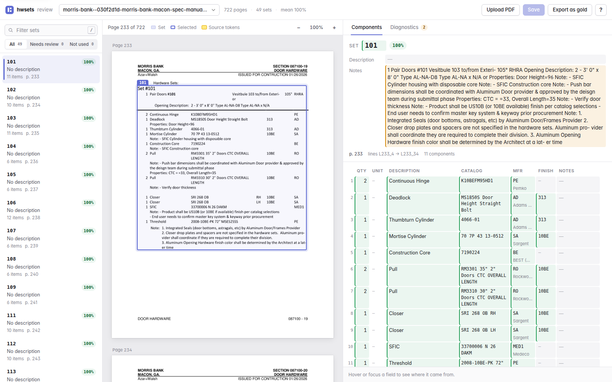
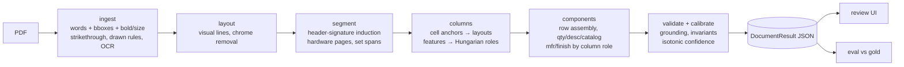

# hwsets: grounded hardware-set extraction from Division 08 specbooks

`hwsets` finds every **door hardware set** in a specbook PDF. A set is a heading such as "Hardware Group No. 01" or
"Set: EX-1.0", plus its component rows. For each component it extracts the quantity, description, catalog number,
manufacturer, finish and notes. **Every value points to the real words it came from, with their coordinates on
the page.** Sets are located by page, bounding box and line range.

Structural decisions are made once for the whole document rather than value by value: where sets start, which
column is the manufacturer and which is the finish. The pipeline is deterministic, with no LLM in the loop.
Results:

- **Gold books** (8 books, 279 sets, 2,184 components, labelled by hand from page images):
  - 100% set recall
  - 99.3% component F1
  - 87.1% of sets fully correct
  - zero manufacturer↔finish confusions
- **Negative books:** zero false sets across 21 sections that contain no hardware sets.

A review UI shows each page with the extraction overlaid. Hovering any field lights up its source words; any cell
can be corrected and exported as a gold label.



## Quickstart

```bash
make setup                 # uv sync (Python 3.12)
make ingest                # tokenize data/raw/**/*.pdf into data/tokens (cached by sha256)
make demo                  # extract 3 demo books and serve the review UI on http://localhost:8000
```

Other targets:

| Command | What it does |
|---|---|
| `uv run hwsets extract <doc_id> --flat` | Extract one book into `data/results/` |
| `make eval` | Score against gold; writes `eval/report.md` |
| `make test` | Run the test suite |
| `docker compose up` | Run everything in a single image, with Tesseract included (see the note below) |

Specbook PDFs are not committed. Put them under `data/raw/`; each book's `doc_id` is derived from its path.

**Docker:** the Dockerfile and docker-compose file are written and lint-checked, but the image has not been built
here: Docker Desktop's WSL integration was not running on the build machine. Run `make docker` to verify it on a
machine with a Docker daemon. The review UI also accepts new PDFs via **Upload PDF**, which runs
`POST /api/docs/upload` to ingest and extract the file.

## Architecture



| Stage | Module | What it does |
|---|---|---|
| Ingest | `ingest/pdf.py`, `ingest/store.py` | PyMuPDF words with bboxes on the page as displayed (rotation applied), font size and bold. Two kinds of strikethrough are flagged: MuPDF's per-span strikeout flag and vector lines drawn through the middle of a word. Thin drawn rules (table borders) are kept. OCR runs on image-only pages. The cache is sharded by page and keyed by sha256. |
| Layout | `layout/lines.py`, `chrome.py`, `columns.py`, `rules.py` | Groups tokens into visual lines by vertical overlap, so geometry decides membership, not PyMuPDF's word order. Drops icon glyphs and rotated watermarks. Removes running headers and footers that repeat on at least half of the pages. Finds column anchors from where cells start and groups pages into layout clusters. |
| Segment | `segment/headers.py`, `section.py`, `sets.py` | One permissive header grammar plus per-document signature induction (details below). Header-driven hardware-page detection. A table SET column is handled by bare-id induction. Splits the stream at headers, so a page break is never a boundary. Classifies set-level text: door lists, "Provide each…", operation blocks, notes. |
| Column roles | `columns/features.py`, `assign.py`, `legend.py`, `template.py`, `lexicon.py` | Computes per-column value distributions and assigns roles with `scipy.optimize.linear_sum_assignment`. Header-row priors and the book's own legends feed in. Records a margin per column. A positional template is the fallback for unaligned lists. |
| Components | `components/parse.py`, `lookup.py` | Row assembly covers wrapped cells, vertically centred cells, ruled-table borders and notes. Quantity is never guessed. The description/catalog split, revision tags and same-page lookup codes are handled here. |
| Validation | `validate.py`, `calibration.py` | Grounding check: a value must equal its tokens' text up to normalization. Also invariants, duplicate set numbers and per-field isotonic calibration. |
| I/O | `cli.py`, `api/` | `hwsets ingest\|extract\|eval\|calibrate\|serve…` and the FastAPI review UI. The pure stages above do no I/O. |

### Header signature induction

There are no per-format regexes. Every line is parsed with one grammar:
`[outline numbering] KEYWORDS ID [and ID…] [- title]`, where KEYWORDS is drawn from {HARDWARE, GROUP, SET,
HEADING, HW, NO., #, :}.

Each candidate is scored on four things:
- keyword strength
- typography (bold, larger size)
- shortness
- **evidence**: whether component rows follow it

The canonical keyword bag with the most support wins, and every line that matches it becomes a header. This one
mechanism handles all of these:
- `Hardware Group No. 01`
- `HARDWARE GROUP NO. C00.EXT`
- `PART 60 - HARDWARE GROUP NO. 103A` (auto-numbering)
- `Set: EX-1.0`
- `Set #AL 01`
- `Heading #17`
- `HW 02A Interior …`
- `Hardware Group/Set #B1 and #B2`

A table whose set ids sit in a SET column (`1.1 | MORTISE HINGE | IVES - 5BB1 …`) is found by bare-id induction
instead. The ids must be unique and ascending at one x position, and their lines must carry manufacturer or
finish codes.

## How each caveat is handled

**1. Manufacturer vs. finish codes are ambiguous** (`columns/assign.py`, `features.py`, `legend.py`)
- A value never decides its own role. Roles are assigned to *columns*, using the distribution of all of that
  column's values in the layout:
  - share of manufacturer codes
  - share of finish codes
  - share shaped like quantities
  - share shaped like catalog numbers
  - share that are words
  - fill
- Collision codes (`PE` = Pemko or Painted Enamel, `NO`, `AL`, `SP`, …) carry **zero** evidence for either role.
  They take their column's role. "PE" in a manufacturer column becomes Pemko; in a finish column it is a finish.
- The book's own legends override the lexicon:
  - morris-bank's `PE Pemko` makes PE strong manufacturer evidence;
  - its finish legend defines `10BE`, `313` and `EB`.
- A column-header row (`MFR`, `FINISH`, `QTY`, …) adds a strong prior, even when it repeats on every page and is
  otherwise removed as chrome.
- Result on gold: 1,482 of 1,482 manufacturer codes and 1,546 of 1,546 finish codes land in the right role.

**2. Set boundaries can be subtle** (`segment/headers.py`, `segment/sets.py`)
- Boundaries come only from the induced header signature, or from changes in the SET column.
- Blank rows and page breaks never split a set.
- Lines between a header and its item table (door grids with room names, "Provide each … with the following:")
  are set-level, not components. So are prose blocks after "Operational Description:".

**3. NOT USED / N/A sets** (`segment/headers.py:NOT_USED_RE`, `segment/sets.py`)
- `NOT USED`, `N/A`, `OMITTED`, `DELETED`, `VOID` and `MOVED TO` are recognised as standalone phrases on the
  header line or on the first line after it.
- Such sets are kept with `status="not_used"`, `status_text` and zero components.
- "N/A" deeper inside a set is ordinary text.

**4. Sets spanning page breaks** (`layout/chrome.py`, `pipeline.py`)
- All hardware pages form one line stream with chrome removed.
- A set's location has one region per page it touches, plus a `line_range`.
- Headers orphaned at the bottom of a page join the body on the next page.

**5. Column layouts differ between books** (`layout/columns.py`, `columns/template.py`)
- Column anchors are inferred per *layout cluster*: one PDF can bind two consultants' schedules (morris-bank).
- Roles may be absent: valor has no manufacturer or catalog column, jc-ryan has no finish, bridgeport has no
  manufacturer.
- Merged cells are split by document-level majority:
  - `IVES - 5BB1` (manufacturer + catalog)
  - `2 Continuous Hinge` (quantity + description)
- Free-flowing lists with no aligned columns use one positional template inferred from the whole document.

**6. Missing quantities become `null`** (`components/parse.py:_parse_qty`)
- Quantity comes only from the quantity column, or from a leading count when quantity shares the description
  cell.
- `--`, blanks, `As Req` and `__ Ea.` all give `null`. It is never defaulted to 1.

**Also handled**
- **Redlines:** struck-through deletions are dropped from values but kept as evidence (sjc, hfh, valor).
- **Wrapped cells:** reading order comes from geometry. Text from wrapped cells often appears *after* the
  finish/manufacturer in PyMuPDF's word order; it is reassembled into the right cell anyway.
- **Vertically centred multi-line cells** (jc-ryan).
- **Ruled tables:** drawn borders are exact row boundaries.

## Evaluation

Gold labels were drafted from rendered page images by independent labelling agents, following
`docs/gold-guidelines.md`. **The extractor was never run on a gold book before its gold file was finished**, and
the CLI enforces this (`"_final": true`).

Split assignments and the format survey are in `data/splits.json` and `data/survey.md`: 8 gold books covering
every format cluster, 2 held-out books and 10 dev books. Full report: `eval/report.md`.

| Book (format cluster) | Sets | Set R / P | Components R / P | Fully correct |
|---|---|---|---|---|
| valor (minimal list, no manufacturer or catalog, redlines) | 37 | 100 / 100 | 100 / 99.6 | 94.6% |
| roselle (ruled table, SET column, merged manufacturer-catalog) | 33 | 100 / 100 | 100 / 100 | 75.8% |
| jc-ryan (`Set:` list, centred cells, no finish) | 38 | 100 / 100 | 98.5 / 100 | 73.7% |
| gerrard (`Set #` list with legends) | 35 | 100 / 100 | 100 / 100 | 91.4% |
| lyons (`Hardware Group` template, NOT USED, door grids) | 29 | 100 / 100 | 100 / 100 | 100% |
| hfh (Allegion table, redline V16→V17), pp 20–40 | 25 | 100 / 100 | 98.6 / 99.4 | 72.0% |
| bridgeport (supplier submittal, `Heading #`), pp 3–18 | 31 | 100 / 100 | 100 / 98.9 | 87.1% |
| sjc (`HW` redline, moved/retired stubs), pp 711–724 | 51 | 100 / 96.2 | 94.4 / 100 | 96.1% |
| **Total (micro)** | **279** | **100 / 99.3** | **98.9 / 99.7** | **87.1%** |

**Field accuracy** on matched components, as exact matches after normalization:

| Field | Accuracy |
|---|---|
| qty | 99.7% |
| unit | 100% |
| description | 99.1% |
| catalog | 99.6% |
| manufacturer | 99.95% |
| finish | 100% |
| notes | 99.4% |

**Location:** mean IoU against hand-drawn boxes is 0.92.

**Blind baseline vs. now.** The first eval was run before any rule had seen a gold book. That baseline was:
- set recall 88.2%
- component F1 97.4%
- 31.2% of sets fully correct

Every fix since then is a general rule, verified on the dev and negative books, and logged with its error
category in `docs/DECISIONS.md` (Checkpoint 6b). Because the gold books then informed those fixes, **the held-out
books below are the honest generalization number.**

**Held-out books** (never opened during development; gold drafted at the end by a separate agent):
HELDOUT_RESULTS

**Confidence** (`calibration.py`): per-field isotonic calibration fitted on gold. Measured accuracy is very high, so most fields calibrate close to 1.0 and the set badges spread little. The relative ordering still drives the UI's review queue. In-sample, fields scored ≥ 0.9
are 99.7% exact and fields scored 0.8–0.9 are 93.5% exact. The UI's `n` key jumps to the low-confidence fields
first.

**Known failures** (honest examples):
- **hfh, an `ELEC FIRE EXIT HARDWARE` qty `2 (1)` cell:** both the `2` and the struck `(1)` carry MuPDF's
  strikeout flag, so the quantity comes out `null` (gold is 2).
- **Wrapped "DIAGRAMS" rows printed without a quantity** directly under a complete row are sometimes merged into
  it (hfh).
- **Roselle notes column:** a few multi-line notes join a following remark line.
- **starhardware (dev):** paragraph-long catalog cells with images and sentence-form headers ("For doors assigned
  Hardware Group/Set #103 …") are found only partially. About 70 of about 74 sets.

## Design decisions and tradeoffs

- **Deterministic first.** Every value is grounded in tokens, so a wrong value is always explainable: its source
  words can be shown on the page. Rules are cheap, fast and reproducible. The largest book, 3,930 pages, extracts
  in about 14 s.
- **No per-format parsers.** Formats differ in surface details, not in structure. One header grammar with
  document-level induction, plus distribution-based column roles, covers all 18 surveyed books, including
  formats added late (the SET-column table). No rule keys on a filename or book. Rules that came from a single
  book are listed in `docs/DECISIONS.md`.
- **LLM layer: not built, by measurement.** The plan allows one only where rules demonstrably fail. After the
  error analysis, no cluster of rule-resistant errors was left: the remaining errors are individual ambiguities
  such as struck quantity glyphs and unlabelled wraps, which a model would also have to guess. If one were added,
  it would answer only with token ids and enum roles (grounded), with record/replay so it needs no API key, and
  it would ship disabled unless it gains more than 1 point.
- **With more time:**
  - layout-aware table-cell detection from drawn grids (starhardware);
  - learning the item vocabulary across books;
  - a small active-learning loop from UI corrections into calibration;
  - more held-out books.

## How AI was used, and where it wasn't trusted

Claude Code built this repository against `PLAN.md`, coordinating agents to:
- survey the specbook formats;
- draft gold labels;
- build the eval module, the review UI and the test suite (in isolated git worktrees);
- package the deliverable.

Where AI output was not trusted:
- **Gold labels are independent of the extractor.** They were transcribed from page images. Agents were barred
  from extractor code and output, and the CLI refuses to run gold books until labels are final. Labels were
  spot-checked against page images, and a labelling-convention disagreement was resolved explicitly and logged.
- **Every rule is tested.**
  - 298 tests: unit tests, Hypothesis property tests and golden regression tests.
  - The property tests check:
    - role assignment does not change when columns are permuted;
    - collision codes take their column's role;
    - a page break never splits a set;
    - NOT USED sets have zero components;
    - every row in comes out as a component;
    - a missing quantity is null;
    - every value is grounded.
  - The property suite found 8 real bugs. Each was pinned as a strict xfail test, then fixed.
- **Hold-out discipline is enforced in code.** `hwsets extract` refuses held-out books without `--allow-holdout`.

## Output

`DocumentResult` is the single source of truth (`src/hwsets/models.py`; JSON Schema in `schema.json` via
`make schema`). Every `Field` has `value`, `token_ids`, `confidence` and `source` (rule / lookup / llm / human).

```json
{"set_number": {"value": "1", "token_ids": ["p406_w31"], "confidence": 0.95, "source": "rule"},
 "status": "active", "location": {"regions": [{"page": 406, "bbox": [72.0, 361.8, 545.2, 621.0]}],
 "line_range": ["L406_16", "L406_33"]},
 "components": [{"qty": {"value": 4, "token_ids": ["p406_w58"]}, "qty_unit": "EA",
   "description": {"value": "HINGE"}, "catalog_number": {"value": "5BB1 4.5 X 4.5 NRP"},
   "mfr": {"value": "IVE"}, "mfr_resolved": "H.B. Ives", "finish": {"value": "630"}, "notes": {"value": null}}]}
```

`hwsets extract <doc_id> --flat` also writes the brief's plain shape (`set_number`, `description`, `location`,
`components[]` with plain values). This is also the gold format.

## Repository map

```
src/hwsets/      pipeline stages (pure) + cli.py + api/ (I/O)
tests/           unit/, property/ (Hypothesis), golden/ (regression gate)
data/            survey.md, splits.json, gold/*.gold.json, calibration.json (raw PDFs and caches are gitignored)
docs/            DECISIONS.md (decision log + checkpoints), gold-guidelines.md, demo-script.md
```
